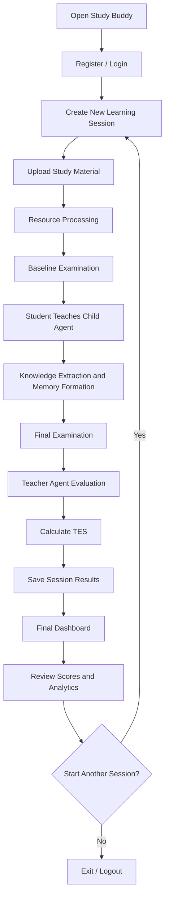

# Full Study Buddy Workflow, Auth, Analytics & Light/Dark Theme Implementation Plan

> **For agentic workers:** REQUIRED SUB-SKILL: Use superpowers:subagent-driven-development (recommended) or superpowers:executing-plans to implement this plan task-by-task. Steps use checkbox (`- [ ]`) syntax for tracking.

**Goal:** Transform Study Buddy into a 100% complete, production-grade application implementing the full Feynman learning loop: User Registration/Login, Multi-Session Management, Baseline Examination, Interactive Teaching, Final Exam, rigorous TES calculation, Historical Analytics Dashboard, and a designer-grade Light/Dark mode toggle.

**Architecture:** 
- **Backend:** FastAPI with an embedded, persistent SQLite database (`frontend/api/studybuddy.db`), PBKDF2 cryptographic password hashing, token-based session authentication, and RESTful CRUD endpoints for sessions, exams, and analytics.
- **Frontend:** React 19 + TypeScript + Tailwind CSS with a unified Theme Context (`light` / `dark`), clean step-driven navigation matching the target flowchart (`A` through `P`), interactive charts, and printable PDF reporting.
- **AI Dual-Agent Engine:** Teacher Agent (ground truth extractor & grading judge) and Child Agent (isolated learner attempting baseline & final exams via strictly partitioned memory).

**Tech Stack:**
- Frontend: React 19, TypeScript, Tailwind CSS v4, Lucide Icons, GSAP, Framer Motion, jsPDF
- Backend: Python 3.13, FastAPI, SQLite3 (standard library), PyMuPDF (fitz), Ollama (Llama 3.1) with Gemini fallback

## Global Constraints
- Zero breaking changes to the local Ollama Llama 3.1 integration or Vercel serverless folder structure (`frontend/api`).
- Strict isolation of Child Agent memory: The Child Agent must NEVER see the raw uploaded document; it can only answer using concepts extracted from student teaching.
- Light mode must look polished and executive: soft slate/zinc backgrounds (`bg-slate-50` / `#FAFAFA`), subtle borders (`border-slate-200`), dark charcoal text (`text-slate-900`), and clean elevation shadows—not stark unstyled white.
- All persistent data (users, sessions, baseline scores, final scores, concepts, question breakdowns) must survive browser refreshes and server restarts via SQLite.

---

## Target Workflow Mapping

---

## Task Decomposition

### Task 1: Backend Database & Persistent Storage Layer
**Files:**
- Create: `frontend/api/database.py`
- Modify: `frontend/api/index.py`
- Test: `frontend/api/test_db.py`

**Interfaces:**
- Consumes: Standard Python `sqlite3`, `hashlib`, `secrets`, `json`
- Produces: Database initialization (`init_db()`), connection manager, and model helpers for Users, Sessions, Concepts, Questions, and ExamGrades.

- [ ] **Step 1: Write DB unit tests verifying schema creation and CRUD**
  - Verify tables are created: `users`, `sessions`, `concepts`, `questions`, `exam_results`.
  - Test user creation, password verification with salt, session saving, and query retrieval.
- [ ] **Step 2: Implement `frontend/api/database.py`**
  - Schema definition with foreign keys and indexes.
  - Implement functions: `create_user`, `authenticate_user`, `create_session`, `update_session_scores`, `save_session_concepts`, `save_exam_results`, `get_user_sessions`, `get_session_details`.
- [ ] **Step 3: Run DB unit test and verify**
  - Command: `./frontend/api/venv/bin/python frontend/api/test_db.py`
- [ ] **Step 4: Commit database layer**

---

### Task 2: Authentication System & User Session Management
**Files:**
- Create: `frontend/api/routers/auth_routes.py`
- Modify: `frontend/api/index.py`
- Create: `frontend/src/context/AuthContext.tsx`
- Create: `frontend/src/components/AuthModal.tsx`
- Modify: `frontend/src/App.tsx`

**Interfaces:**
- Consumes: `database.py` auth methods
- Produces:
  - Backend: `POST /api/auth/register`, `POST /api/auth/login`, `GET /api/auth/me`
  - Frontend: `useAuth()` hook providing `user`, `login(email, pass)`, `register(name, email, pass)`, `logout()`.

- [ ] **Step 1: Create `auth_routes.py` with registration, login, and token session verification**
- [ ] **Step 2: Mount `auth_routes` on FastAPI `app` in `frontend/api/index.py`**
- [ ] **Step 3: Create React `AuthContext` to manage local storage token, user state, and auth headers**
- [ ] **Step 4: Create responsive, polished `AuthModal.tsx` (Sign In / Sign Up tabs) with Light/Dark support**
- [ ] **Step 5: Verify auth workflow via automated curl test and browser login**
- [ ] **Step 6: Commit authentication system**

---

### Task 3: Universal Dark / Light Theme System
**Files:**
- Create: `frontend/src/context/ThemeContext.tsx`
- Create: `frontend/src/components/ThemeToggle.tsx`
- Modify: `frontend/src/index.css`
- Modify: `frontend/src/pages/LandingPage.tsx`
- Modify: `frontend/src/pages/StudyTool.tsx`

**Interfaces:**
- Produces: `useTheme()` hook (`theme: 'dark' | 'light'`, `toggleTheme()`).
- Applies `.dark` or `.light` class to document root, updating CSS variables and Tailwind classes.

- [ ] **Step 1: Create `ThemeContext.tsx` with system preference detection and `localStorage` persistence**
- [ ] **Step 2: Create a beautiful, floating / navbar `ThemeToggle.tsx` with smooth micro-animations (Sun/Moon icon)**
- [ ] **Step 3: Refactor styling tokens across LandingPage and StudyTool**
  - Dark: Obsidian `#050507`, `#0a0a0c`, `text-zinc-100`, `border-white/10`
  - Light: Soft Executive `#F8FAFC`, `#FFFFFF`, `text-slate-900`, `text-slate-600`, `border-slate-200/80`, subtle shadow cards
- [ ] **Step 4: Verify theme toggles smoothly without layout jumps or contrast issues**
- [ ] **Step 5: Commit theme system**

---

### Task 4: Workflow Realignment — Session Creation & Baseline Examination (Flowchart C, D, E, F)
**Files:**
- Create: `frontend/api/routers/session_routes.py`
- Modify: `frontend/api/routers/ml_routes.py`
- Create: `frontend/src/components/SessionSetupModal.tsx`
- Modify: `frontend/src/pages/StudyTool.tsx`

**Interfaces:**
- Backend:
  - `POST /api/sessions/create`: initializes session with title and topic.
  - `POST /api/ml/run-baseline-exam`: Child Agent answers exam questions *before* any teaching occurs. Answers are graded by Teacher Agent to establish the `baseline_score` (Cold Baseline).
- Frontend:
  - Step 1: Session Setup & Document Upload
  - Step 2: Resource Processing & Automated Baseline Exam (Child Agent attempts test cold, displays Baseline Score, e.g. 10/100)

- [ ] **Step 1: Implement `session_routes.py` for session lifecycle management**
- [ ] **Step 2: Implement `/api/ml/run-baseline-exam` in `ml_routes.py`**
  - Child Agent responds with empty or rudimentary knowledge.
  - Teacher Agent grades responses, establishing the baseline score and logging answers.
- [ ] **Step 3: Update `StudyTool.tsx` step progression**
  - Show the Baseline Exam phase: animated progress showing the Child Agent taking the test "cold".
  - Display baseline score prominently with explanation: *"Child Agent currently knows 8% of this material. Now it is your turn to teach it!"*
- [ ] **Step 4: Verify baseline exam execution and persistence**
- [ ] **Step 5: Commit Session Creation & Baseline Exam implementation**

---

### Task 5: Workflow Realignment — Interactive Teaching, Final Exam & TES Engine (Flowchart G, H, I, J, K, L)
**Files:**
- Modify: `frontend/api/routers/ml_routes.py`
- Modify: `frontend/src/pages/StudyTool.tsx`

**Interfaces:**
- Consumes: Session context, baseline score, student teaching transcripts.
- Produces:
  - Rigorous Teaching Efficacy Score (TES):
    $$\text{TES} = \max(0, \text{Final Score} - \text{Baseline Score}) \times \left(\frac{\text{Concept Coverage}}{100}\right)$$
  - Persists full session record to SQLite upon exam completion.

- [ ] **Step 1: Connect teaching text/voice inputs to the active `session_id`**
- [ ] **Step 2: Run Final Examination using taught neural memory**
- [ ] **Step 3: Implement mathematical TES calculation engine with transparent breakdown**
  - Show Baseline Score vs Final Score vs Delta Improvement vs Teaching Efficacy Score.
- [ ] **Step 4: Save complete session outcome automatically to SQLite database**
- [ ] **Step 5: Verify end-to-end execution of baseline -> teach -> final exam -> save**
- [ ] **Step 6: Commit Teaching, Final Exam & TES Engine**

---

### Task 6: Session Dashboard, Historical Analytics & Navigation (Flowchart M, N, O, P)
**Files:**
- Create: `frontend/src/pages/DashboardPage.tsx`
- Create: `frontend/src/components/AnalyticsCharts.tsx`
- Modify: `frontend/src/pages/StudyTool.tsx`
- Modify: `frontend/src/App.tsx`

**Interfaces:**
- Backend:
  - `GET /api/analytics/user-stats`: Aggregate metrics (Total Sessions, Average TES, Best Topic, Total Learning Time).
  - `GET /api/sessions/history`: List of past sessions with scores and dates.
- Frontend:
  - Dedicated Dashboard Page with:
    - Overview KPI cards (Average TES, Sessions Completed, Knowledge Retention Rate).
    - Session History table with "View Exam", "Download PDF", and "Retest" actions.
    - Post-Exam Completion Screen with options: "Start Another Session" (returns to C) or "View History & Dashboard" (M/N).

- [ ] **Step 1: Create analytics backend endpoints in `frontend/api/routers/session_routes.py`**
- [ ] **Step 2: Build `DashboardPage.tsx` with clean metrics cards, session history list, and Light/Dark styling**
- [ ] **Step 3: Update `App.tsx` view router to support `landing`, `study`, `dashboard`**
- [ ] **Step 4: Enhance post-exam completion screen with direct action buttons (`Start Another Session` or `Exit to Dashboard`)**
- [ ] **Step 5: Verify all analytics and session history load correctly from SQLite**
- [ ] **Step 6: Commit Dashboard, Analytics & Navigation**

---

## Verification & Acceptance Criteria
1. **Flowchart Adherence:** Full walkthrough follows nodes `A` through `P` without missing steps.
2. **Authentication:** User can register, log in, log out, and session data is securely partitioned by user.
3. **Baseline vs Final Exam:** Child Agent is tested cold (baseline) and after teaching (final); TES reflects delta improvement.
4. **Data Persistence:** Refreshing the browser or restarting backend maintains user accounts, session history, and past exam grades in SQLite.
5. **Theme Switching:** Switching between Dark Mode and Light Mode is seamless and looks visually stunning in both modes.
6. **Vercel & Offline Compatibility:** Preserves Ollama Llama 3.1 local offline workflow and directory structure.
